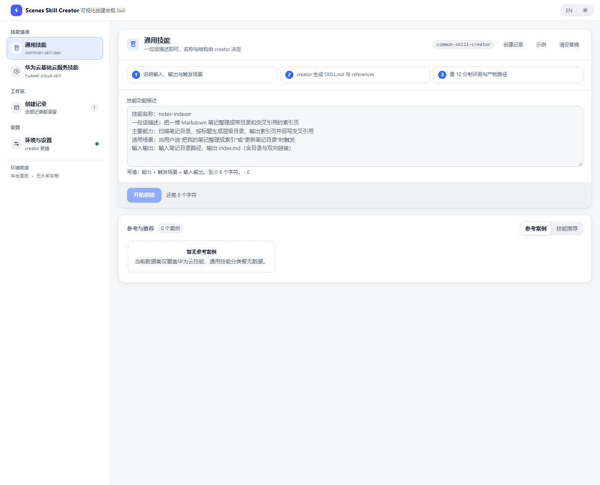

# Scenes Skill Creator（DeepSeek Harness 插件）

在 DeepSeek Harness 的 Web 界面里，用一套完整面板创建技能：填写需求 → 调用官方 creator → 实时查看阶段 / 日志 → 10 分制评测 → 未达标打回修复，直到达标或用完轮数。



## 功能

- **两个场景**：通用技能（`generic`）和华为云基础云服务技能（`huawei`）。
- **真实 creator 执行**：插件不生成内容，而是把需求交给 `common-skill-creator` / `huawei-cloud-skill-creator`；支持拉取、缓存和展示 creator 版本。
- **实时运行面板**：创建、评测、修复三个阶段实时更新；阶段、步骤日志、产物、评测报告均可查看。
- **评测与修复**：10 分制评分，默认通过线 8.5；未达标时自动打回同一个 creator 修复。
- **通用技能快速模式**：默认只跑 1 轮评测，结果页可反复手动「继续修复并复评」，直到达标或你停止。
- **创建记录**：华为云和通用记录统一展示，支持类型 / 状态筛选；记录不设数量上限。
- **安装 / 启用**：结果页可把成品技能复制到 DSH 用户技能目录并刷新技能发现。
- **远程参考数据**：参考案例和推荐技能来自公共数据仓库，插件内不写死；网络失败时回落到上次成功缓存。
- **面板内推荐网址**：AI Shell、Grape、华为云 Skills 官网。

## 仓库

- GitHub：`https://github.com/huaweicloudskill/scenes-skill-creator`
- GitCode：`https://gitcode.com/developer-skill/scenes-skill-creator`

两个仓库保持同一份插件代码；参考与推荐数据单独放在 `common-skill-dev@dsh-plugin` 分支。

## 架构

```text
DSH Web
 └─ client (src/client.js)
     └─ iframe  /scenes-skill-creator/app/     ← assets/panel.html
          └─ assets/panel-bridge.js            ← 原型 UI ↔ Host API 适配
               └─ fetch /scenes-skill-creator/api/*（同源，无 CORS）
                    └─ Host (src/core/plugin.mjs)
                         ├─ ctx.skills.registerProvider  （注册两个官方 creator）
                         ├─ ctx.webServer  （API + 静态面板）
                         └─ runner / evaluator  （创建 → 评测 → 打回修复）
```

- 所有逻辑都在 Harness 进程内，不额外监听端口。
- 面板 UI 以 `assets/panel.html` 交付，`assets/panel-bridge.js` 只替换数据源，不改视觉与交互。
- 记录持久化、看门狗、评测门禁参考官方 `@cloudplugin/scenes-skill-creator` 的 Host 实现，并去掉了记录数量上限。

## 目录

| 路径 | 作用 |
| --- | --- |
| `src/client.js` | Web client：注册 sidebar 图标 + main slot，iframe 铺满 |
| `assets/panel.html` | 面板 UI（发布版） |
| `assets/panel-bridge.js` | 面板 ↔ Host API 适配（run / 记录 / 目录 / 环境 / 参考数据 / 安装） |
| `src/core/plugin.mjs` | Host 入口：creator provider、API、静态面板路由 |
| `src/core/routes.mjs` | `/scenes-skill-creator/api` 与 `/scenes-skill-creator/app` |
| `src/core/runner.mjs` / `evaluator.mjs` | 创建、修复、评测流程 |
| `src/core/creators.mjs` / `catalog.mjs` | 官方 creator 拉取、华为云三级目录 |
| `src/core/refs.mjs` | 公共仓库参考/推荐数据：GitCode base64 解码、校验、last-good 缓存 |
| `bin/` | CLI 辅助工具 |
| `test/host/` / `test/bridge/` / `test/client/` | Host 单测、bridge + mock API + 无头 Edge 测试 |
| `cordis.patch.yml` | bundle 声明与默认配置 |

## 安装

本包尚未发布 npm，按本地 bundle 安装。

```powershell
git clone https://github.com/huaweicloudskill/scenes-skill-creator.git
cd scenes-skill-creator

# 或使用 GitCode 镜像：
# git clone https://gitcode.com/developer-skill/scenes-skill-creator.git

# 进入 DSH desktop profile，把本仓库作为本地依赖加入
cd $env:USERPROFILE\.dsh\profiles\desktop
pnpm add <本仓库的绝对路径>

# 确认 profile 已注册：
#   dsh.profile.bundles 包含 "scenes-skill-creator"
#   cordis.patch.yml 的插件条目 id / name 均为 "scenes-skill-creator"
```

也可以直接使用 DSH「插件」页面里的本地目录安装能力；不同 DSH 版本的入口名称可能不同。

安装后需要**重启一次 DSH**。bundle 列表、补丁层和 client 资源只在启动时解析；不重启的典型表现是侧栏没有图标，或 `/scenes-skill-creator/api` 404。

### 首次安装检查清单

1. 侧栏出现 **Scenes Skill Creator** 图标，面板显示两个场景、「参考案例 / 技能推荐」和推荐网址；
2. 通用技能填写需求并开始创建，运行页出现阶段与步骤日志，结束后进入结果页并显示评测分；
3. 创建记录可打开详情、返回列表、删除已结束记录；
4. 切到华为云场景，domain / product / name 下拉来自真实仓库；
5. 切换 DSH 主题，iframe 面板跟随；面板内语言 / 主题切换正常。

## 配置

写在 `cordis.patch.yml` 的 `config` 下；profile 覆盖时整块替换。

| 键 | 默认 | 说明 |
| --- | --- | --- |
| `run.cwd` | Host cwd | 技能落盘根：`<cwd>/skills/...`。建议显式设置为你的工作区 |
| `run.permissionPreset` | `danger-full-access` | creator 需要执行 bash/CLI；只读或 workspace-write 会卡在审批。仅在可信工作区使用 |
| `run.passScore` | `8.5` | 10 分制通过线 |
| `run.maxEvalRounds` | `3` | 最多自动评测轮数；`0` 关闭评测 |
| `run.genericFastMode` | `true` | 通用技能快速模式：追加契约优先 / 最小路径 / 复用同域技能等提示词 |
| `run.genericMaxEvalRounds` | `1` | 通用技能最多自动评测轮数；显式值优先于 fast mode |
| `run.evalReadonlyOnly` | `true` | 只跑只读/语法用例 |
| `run.installDir` | `$DSH_HOME/skills`（默认 `~/.dsh/skills`） | 「安装 / 启用该技能」的复制目标；DSH 文件系统 provider 会扫描该目录 |
| `refs.huaweiUrl` / `refs.genericUrl` | 公共仓库 `dsh-plugin` 分支的 GitCode Contents API | 参考案例 / 推荐技能数据源 |
| `refs.refreshMs` | `0` | `0` = 每次 `/refs` 都拉最新；大于 0 时在窗口内复用内存缓存 |
| `refs.timeoutMs` / `refs.maxBytes` / `refs.cacheBust` | `8000` / `1048576` / `true` | 超时、响应上限、是否附加时间戳绕过 CDN |
| `run.*` 预算 / 门禁 | 同官方 Host | token、时长、工具调用、失败/重试上限与门禁压分 |
| `catalog.repo/ref/root` | 华为云仓库 `master` / `skills` | 三级目录来源 |
| `creators.huawei/generic` | 官方仓库与路径 | 两个 creator |

### 通用技能快速模式

通用技能没有固定流水线，容易出现「先写上千行、最后才第一次跑」。插件对 `generic` 额外做了三件事：

1. **创建/修复提示词要求先定契约、先跑最小路径**：先确定子命令、参数、退出码、stdout/stderr 和 JSON 结构，再写 ≤30 行最小路径并真实运行；先写 smoke test 骨架；优先复用工作区同域技能；`SKILL.md` 目标 ≤180 行、references 最多 1 个。
2. **自动评测轮数封顶**：`genericMaxEvalRounds: 1`，华为云仍走 `maxEvalRounds: 3`。
3. **缺失夹具自动补齐**：通用 skill 若没有可解析的 `evals/evals.json`，「功能可用」会直接 0 分。评测前会从 `SKILL.md` 已记录的只读命令示例生成最小夹具（3 条）；评测 agent 仍须实际执行并给出证据，不是白送分。

恢复完整质量闭环：把 `run.genericFastMode` 设为 `false`，或显式写 `run.genericMaxEvalRounds: 3`。

### 手动复评

通用技能默认只跑 1 轮；未达标时结果页出现「继续修复并复评」。每次点击执行一轮「把扣分交回 creator 修复 → 再评测」；仍未达标可以继续点，直到达标或你主动停止，不会自动循环。

原 creator 会话仍在时直接复用；插件重启或旧记录会话结束时，会为复评新起一个 creator，针对现有技能目录修复。接口为 `POST /run/retry {id}`。

### 安装 / 启用

结果页按钮调用 `POST /install {id}`，把成品目录复制到 `run.installDir`，然后调用 `skills.invalidateCache()` 让 DSH 文件系统 provider 重新发现技能。成功后按钮变为「重新安装」，并显示安装路径。

## 参考与推荐数据

数据位于公共仓库 `developer-skill/common-skill-dev` 的 `dsh-plugin` 分支：

```text
huawei/references.json    5 个案例；7 个 domain 每个最多 10 条推荐，当前前四条：
                          find-skills → billing-scout → ecs-alert → install-openjiuwenswarm
generic/references.json   2 个案例（通用 / 华为云 Skill 创建）+ 10 个精选推荐
references.schema.json
```

GitCode 对非默认分支的 raw 地址返回 403，所以 Host 通过 Contents API 拉取并解码 base64。每次 `/refs` 按 `refs.refreshMs` 拉取（默认每次），失败时依次使用内存 last-good、磁盘 last-good、空数据。案例和推荐全部来自 JSON；发布版 `assets/panel.html` 不包含数据快照，Host 也不再注入任何固定案例。

## API

前缀：`/scenes-skill-creator/api`

```text
GET  /status                      面板 / creator / catalog 状态
GET  /catalog?path=skills         华为云目录（懒加载）
GET  /creator?mode=generic|huawei 拉取 / 查看官方 creator
GET  /refs                        参考案例 / 技能推荐（公共仓库最新数据，失败回 last-good）
POST /run        {spec}           开始创建
POST /run/retry  {id}             手动修复 + 下一轮评测
POST /install    {id}             安装 / 启用成品技能
POST /cancel     {id}             取消运行
POST /handoff    {spec}           调试：creator 请求文本
POST /validate   {path,mode}      结构校验
GET  /run | /run?id=              记录列表 / 单条详情
DELETE /run?id=                   删除已结束记录（运行中需先取消）
```

`spec`：

```js
{ mode: "generic", description: "..." }
{ mode: "huawei", name: "huawei-cloud-ecs-manage", domain: "computing", product: "ecs", description: "..." }
```

## 开发与验证

```sh
npm test          # host + bridge + client 测试
npm run check     # node --check src/client.js 与 assets/panel-bridge.js
```

- Host 测试使用 mock，不访问网络、不启动真实 agent。
- Bridge 测试启动本地 mock API，用无头 Microsoft Edge 打开面板；未安装 Edge 时会显式 skip。
- 覆盖 `full`、`cancel`、`retry` 三个 bridge 场景，以及 Host 路由、runner、refs、creator、client 单测。

当前测试结果：`npm test` → **62 tests / 0 fail**。

## 行为与限制

1. **不做内容创作**：`SKILL.md`、references、测试夹具由官方 creator 生成。
2. **必须能跑 creator**：需要网络访问 gitcode.com、`git`、`bash`（Windows 用 Git Bash）、`python3`；华为云场景还需要可用的 hcloud/AKSK 配置。
3. **默认完整权限**：creator 要执行 bash/CLI；仅在可信工作区使用。
4. **记录不设数量上限**；日志显示截断到最近 120 步，Host 侧保留 200 步。
5. **参考案例 / 推荐技能来自公共仓库**：页面加载时请求 Host `/refs`；远程失败使用 last-good，不会影响创建流程。视频/仓库链接只在点击时打开。
6. **UI 是 iframe**：原型有独立顶栏、语言/主题切换；加载时用 `?theme=`，之后通过 `postMessage({type:"sc-theme"})` 与 DSH 主题同步。
7. **Host 快照没有文件统计**：结果页「产物」显示 0 文件 / 0.0 KB；bridge 不伪造。
8. **记录删除**：调用 `DELETE /run?id=` 持久删除；运行中的记录会被拒绝（先取消再删）。
9. **环境页来自真实探测**：`/status` 返回 git / bash / python / AKSK 环境变量或 `~/.hcloud` 配置；「gitcode 可达」按接口请求成功计。
10. **轮询固定 1s**；404 停止轮询，其它瞬时错误继续重试。
11. **未实现**：平台侧 PR / A2A 交接；标准 API 场景已移除。

## License

MIT。Host 流程参考官方 `@cloudplugin/scenes-skill-creator` 的设计。